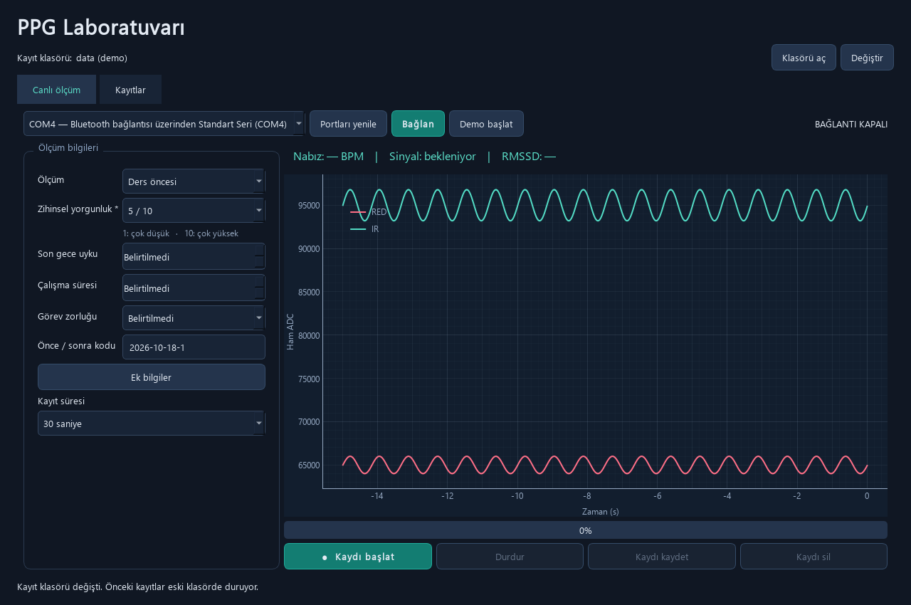
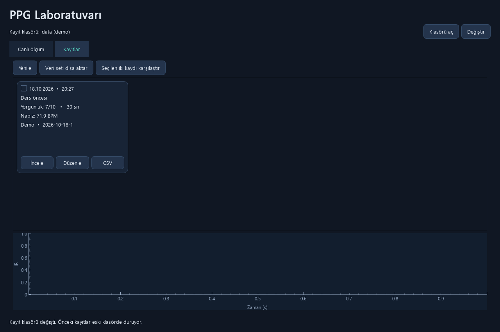

# PPG Laboratuvarı

MAX30102 ve ESP32-C3 kullanarak zihinsel yorgunluk araştırması için **PPG verisi toplama ve etiketleme** uygulaması. Türkçe Windows arayüzünün tamamı `main.py` içindedir. Bu sürümde model eğitimi ve yorgunluk tahmini bulunmaz.

## Klonla ve çalıştır

**Gereken:** Windows 10/11, Python **3.11–3.14 / 64-bit** ve ilk kurulumda internet. Python 3.11 veya 3.12 önerilir. Python kurulurken **Add Python to PATH** seçeneğini işaretleyin.

```powershell
git clone https://github.com/beratoz/Saglikta_Yapay_Zeka_DersiProjesi.git
cd Saglikta_Yapay_Zeka_DersiProjesi
.\Baslat.bat
```

Dosya Gezgini'nden **Baslat.bat** dosyasına çift tıklamak da yeterlidir. İlk çalıştırmada gerekli paketler `.venv` ortamına kurulur. Sonraki açılışlarda tekrar kurulum yapılmaz. **Demo başlat** ile donanım olmadan denenebilir.

Kurulumu ayrı yapmak için `Kurulum.bat` çalıştırın. Yerel `.venv` yoksa başlatıcı mevcut `miniconda3/envs/ppg_env` ortamını da kullanabilir; **Conda zorunlu değildir**.

Elle kurulum:

```powershell
python -m venv .venv
.\.venv\Scripts\python.exe -m pip install -r requirements.txt
.\.venv\Scripts\python.exe main.py
```

## Kullanım

1. Cihazın COM portunu seçip **Bağlan** deyin veya **Demo başlat** kullanın.
2. Yorgunluk puanını seçin; uyku, çalışma süresi ve görev zorluğunu girin. Diğer alanlar **Ek bilgiler** altında açılır.
3. Aynı çalışma oturumunun önce ve sonrası için aynı eşleştirme kodunu kullanın.
4. Süreyi seçip **Kaydı başlat**, ölçüm sonunda **Kaydı kaydet** deyin.
5. **Kayıtlar** sekmesindeki tarihli kartlardan sinyali inceleyin, etiketleri düzenleyin veya ham CSV alın. İki kartı işaretleyerek karşılaştırın. Etiketli özellikler ayrıca CSV olarak dışa aktarılabilir.

Kayıt klasörü üstte görünür; **Klasörü aç** ve **Değiştir** düğmeleriyle yönetilir. Klasör değiştirmek eski kayıtları taşımaz. Varsayılan `data` klasöründe ham sinyaller CSV, etiketler ve özetler SQLite olarak tutulur. Yedeklemek için klasörün tamamını kopyalayın. Veriler buluta gönderilmez.





## Donanım ve karta yükleme

USB'yi çıkararak, **3.3 V uyumlu MAX30102 breakout modülünde** şu bağlantıları yapın:

| ESP32-C3 Super Mini | MAX30102 |
|---|---|
| 3V3 | 3.3 V uyumlu VIN / VCC |
| GND | GND |
| GPIO4 | SDA |
| GPIO5 | SCL |

INT bağlantısı gerekmez. Modülün besleme uyumluluğunu ve pin etiketlerini kontrol edin.

**Arduino IDE 2 ile:** Espressif Systems'ın `esp32` kart paketini kurup `arduniodenemesi/ppg_max30102/ppg_max30102.ino` dosyasını açın. Ek sensör kütüphanesi gerekmez.

| Ayar | Değer |
|---|---|
| Board | ESP32C3 Dev Module |
| USB CDC On Boot | Enabled |
| Flash Mode / Frequency / Size | DIO / 40 MHz / 4 MB |
| Upload Speed | 115200 |
| Port | Kendi cihazınızın COM portu |

Yükleme sırasında Python uygulamasının bağlantısı ve Arduino Seri Monitör kapalı olmalı. Yükleme karttaki mevcut programı değiştirir. Kart sürekli bağlanıp kopuyorsa USB'yi çıkarın; BOOT'a basılı tutarak USB'yi takın ve 5 saniye sonra BOOT'u bırakın. Yüklemeden sonra gerekirse yalnızca RESET'e basın.

**ESP-IDF alternatifi:** `firmware` klasörü ESP-IDF 5.3+ projesidir:

```powershell
cd firmware
idf.py set-target esp32c3
idf.py build
idf.py -p COM7 flash
```

COM7 yerine kendi portunuzu yazın. Arduino sürümü ESP32-C3 / 4 MB kartla gerçek donanımda denendi; ESP-IDF sürümü ayrıca doğrulanmadı. İki sürüm aynı seri protokolünü kullanır; yalnızca birini yüklemeniz yeterlidir.

Seri veri biçimi: `PPG,seq,device_ms,red,ir`, 115200 baud, nominal 100 Hz. Zaman damgası sensörün nominal örnek saatinden türetilir; bağımsız saat ölçümü değildir. FIFO/I²C kesintileri bildirilir ve sıra boşluğu bırakılır.

## Etiketler ve analiz

Ana alanlar: ölçüm türü, zihinsel yorgunluk (1–10), son gece uyku süresi, çalışma süresi, görev zorluğu ve eşleştirme kodu. Ek alanlar: ders/görev, algılanan stres, duruş, dinlenme süresi, yakın zamanda kafein/egzersiz ve not. Bilinmeyen alanlar boş bırakılır; otomatik olarak “hayır” sayılmaz. Tarih, saat, süre ve veri kaynağı otomatik kaydedilir.

Yorgunluk puanı kişisel pilot etiketidir; doğrulanmış bir klinik ölçek değildir. Alanlar, [HRV ölçüm önerileri](https://pmc.ncbi.nlm.nih.gov/articles/PMC5316555/) ve [zihinsel yorgunluk araştırmalarındaki](https://www.frontiersin.org/journals/human-neuroscience/articles/10.3389/fnhum.2021.733426/full) ölçüm bağlamı dikkate alınarak seçildi. Kafein/egzersiz zaman pencereleri pratik kayıt tercihleridir.

BPM için en az 15 saniye veri gerekir; canlı nabız son 20 saniyeden hesaplanır. RMSSD/SDNN için en az 60 saniye kesintisiz ve kabul edilmiş sinyal gerekir. Araştırma kaydı için 5 dakika seçilebilir. Kalite göstergesi sezgiseldir. PPG tabanlı PRV, EKG tabanlı HRV ile eşdeğer değildir; bu uygulama tıbbi teşhis aracı değildir.

## Testler

```powershell
.\.venv\Scripts\python.exe -m unittest discover -s tests -p test_core.py
.\.venv\Scripts\python.exe tests/gui_smoke.py
```

Testler sentetik sinyal ve geçici kayıt klasörleri kullanır. Donanım gerekmez; gerçek ölçümlere dokunmaz. Önizlemeleri yeniden üretmek için GUI testine `--screenshots` ekleyin. GitHub Actions aynı testleri Windows/Python 3.11 üzerinde çalıştırır.

`.gitignore`; kişisel ölçümleri, dışa aktarımları, yerel ayarları, Python ortamlarını ve derleme çıktılarını gönderim dışında tutar. Kayıt klasörünü başka bir konuma taşırsanız o konumu da Git'e eklemeyin.
