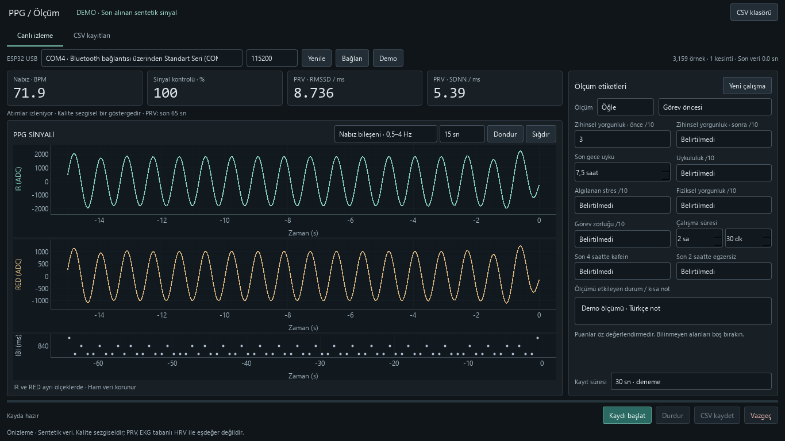

# PPG ölçüm ve etiketleme

ESP32-C3 Super Mini ve MAX30102 ile kişisel araştırma verisi toplamak için
yerel Python uygulaması. Koyu, masaüstü arayüz; canlı RED/IR, atımlar arası süre,
etiketleme ve düzenlenebilir CSV kayıtları. Katılımcı bilgisi istenmez.

## Başlatma

Windows'ta `Baslat.bat` dosyasını açın. Uygulama büyütülmüş normal pencereyle
başlar. Mevcut `.venv` veya `miniconda3/envs/ppg_env` kullanılır. Bunlar yoksa
Python 3.11+ ile yerel `.venv` oluşturulup requirements.txt kurulur.

Elle: `python -m pip install -r requirements.txt`, ardından `python main.py`.
ESP-IDF uygulamayı çalıştırmak için gerekli değildir; firmware karta önceden
yüklü olmalıdır. Uygulama firmware yüklemez veya sensör ayarlarını değiştirmez.

## Bağlantı ve ölçüm

1. ESP32'yi USB ile bağlayın; portu seçin, baud hızını 115200 bırakın ve Bağlan deyin.
   Port başka bir uygulamada açıksa ESP-IDF seri monitörünü kapatın.
2. IR ve RED akışını izleyin. Ham görünüm ADC değerlerini, nabız bileşeni
   0,5–4 Hz filtreli sinyali gösterir. Kanallar ayrı ölçeklerdedir.
3. Aynı satırda Sabah / Öğle / Akşam bölümünü ve görev öncesi/sonrası aşamasını seçin;
   o aşamanın zihinsel yorgunluk puanını girin.
   Diğer alanlar isteğe bağlıdır; bilinmeyen değerler boş kalır.
4. Süreyi seçin, Kaydı başlat deyin. Süre dolunca kayıt durur. Etiketleri kontrol
   edip CSV kaydet ile tamamlayın. Durdur ile kısmi kayıt da alınabilir.
5. Görev sonrası ölçümde aynı çalışma açık kalır. Önce ve sonra puanlarını
   doldurun. Başka bir görev oturumuna geçerken Yeni çalışma deyin.
6. CSV kayıtları bölümünden bir satırı seçip Sinyali incele deyin. Etiketleri
   düzenle, CSV içindeki etiketleri değiştirir; ham sinyali ve özellikleri korur.

Zihinsel yorgunluk, uykululuk, stres, fiziksel yorgunluk ve görev zorluğu
birbirinden ayrı 1–10 öz değerlendirmelerdir (1 çok düşük, 10 çok yüksek).
Bu özel puanlar doğrulanmış klinik ölçekler olarak sunulmaz. Uyku süresi,
çalışma süresi, son 4 saatte kafein, son 2 saatte egzersiz ve kısa not eklenebilir.
Çalışma süresi aynı alandaki ayrı saat ve dakika kontrollerinden girilir. CSV'de
eski kayıtlarla uyumlu olarak toplam dakika (`study_minutes`) tutulur. İki alan
da boşsa süre bilinmiyor demektir; birini doldurmak diğerini görünür şekilde 0 yapar.
Bu zaman pencereleri veri toplama tercihidir.

### Seri veri biçimi

`PPG,seq,device_ms,red,ir` — örnek: `PPG,237,2370,1266,1437`.
COM7 üzerinden 115200 baud ile bu biçim gerçek karttan doğrulandı.
Yeni arayüzün gerçek olay döngüsünde 18 saniyelik bağlantı kontrolünde 1.581
örnek alındı; cihaz zamanından 100 Hz ve sıfır sıra/zaman kesintisi görüldü.
Bu kontrol sırasında CSV kaydedilmedi; bu, PRV veya yorgunluk doğrulaması değildir.
USB port numarası başka bilgisayarda veya USB girişinde değişebilir.
Nominal 100 Hz akış beklenir. Zaman/örnek sırası kesintileri korunur; filtre
kesintinin üzerinden geçirilmez, grafikte boşluk bırakılır.

## CSV biçimi

Her ölçüm `kayitlar/YYYYMMDD_HHMMSS_kod.csv` olarak **tek dosyada** saklanır.
SQLite veya bulut yoktur. UTF-8 BOM ile Türkçe metinler korunur.

- Ham: seq, device_ms, elapsed_s, red, ir.
- Atımlar: peak, ibi_ms, ibi_accepted. IBI yalnızca atım bulunan satırlarda doludur;
  kabul edilip edilmediği ayrıca yazılır. Diğer satırlarda boş olması normaldir.
- Etiketler: day_period (morning/noon/evening), phase (before/after), fatigue_before, fatigue_after, mental_fatigue, sleep_hours,
  sleepiness, stress, physical_fatigue, task_difficulty, study_minutes, caffeine,
  exercise, note. mental_fatigue seçilen aşamanın puanıdır.
  Eski CSV'lerde gün bölümü yoksa otomatik bir bölüm atanmaz; düzenleme sırasında seçilebilir.
- Otomatik: record_id, task_id, created_at, label_time, labels_updated_at,
  source, baud_rate, sample_rate_hz, duration_s, sample_count, missing_samples,
  discontinuities, quality, bpm, prv_rmssd_ms, prv_sdnn_ms, analysis_status,
  requested_duration_s, complete.

Etiketler ve kayıt özeti her örnek satırında tekrar edilir; böylece dosya kendi
başına kullanılabilir. Kaynak DEMO ise sentetik veridir; gerçek verilerle eğitime
karıştırılmamalıdır. Görev öncesi ve sonrası farklı CSV dosyalarıdır ve ortak
task_id ile ilişkilendirilir. CSV klasörünün tamamını kopyalamak yedek için yeterlidir.

Ölçüm tarihi/saati bilgisayardan, örnek zamanları ESP32'den alınır.
sample_rate_hz cihaz zaman damgalarından tahmindir; bağımsız saat doğrulaması değildir.
Eksik değer boş hücredir; 0 veya hayır yapılmaz. Etiket düzenleme geçici dosya
tamamlandıktan sonra CSV'yi değiştirir. Excel dosyayı kilitlerse eski dosya korunur.

## Hesaplamalar ve sınırlar

Nabız için en az 15 saniye, RMSSD/SDNN için en az 60 saniye kesintisiz ve
kabul edilmiş atım dizisi gerekir. Bunlar PPG tabanlı **PRV** özellikleridir;
EKG tabanlı HRV ile eşdeğer kabul edilmez. Kalite yüzdesi basit bir atım düzenliliği
kontrolüdür; klinik doğrulama değildir. Uygulama zihinsel yorgunluğu tahmin etmez,
SpO₂ üretmez. Yorgunluk puanı modelin hedef etiketidir; nabız/PRV model girdileridir.
Kötü sinyalden özellik uydurulmaz. Grafik filtresi ham kaydı değiştirmez.

## Dosyalar ve test

`main.py`: arayüz. `ppg.py`: seri bağlantı, sinyal analizi, CSV.
`requirements.txt` ve `Baslat.bat`: çalıştırma. `kayitlar/`: yalnızca sizin CSV'leriniz.
ESP32 için ESP-IDF kaynakları `firmware/` klasöründe korunur. Python arayüzü
bunları otomatik derlemez veya karta yüklemez. Arduino IDE gerekli değildir.

Kişisel CSV/SQLite kayıtları, dışa aktarımlar, Python ortamları, yerel ayarlar,
`.env` dosyaları ve derleme çıktıları `.gitignore` ile gönderim dışında tutulur.
`docs/` içindeki önizlemeler testlerin ürettiği sentetik verilerdir.

Testler: `python -m unittest discover -s tests -p test_ppg.py` ve
`python tests/gui_smoke.py`. Önizleme için GUI testine `--screenshots` eklenebilir.
Testler geçici klasörde sentetik veri kullanır; kişisel kayıtlara dokunmaz.

